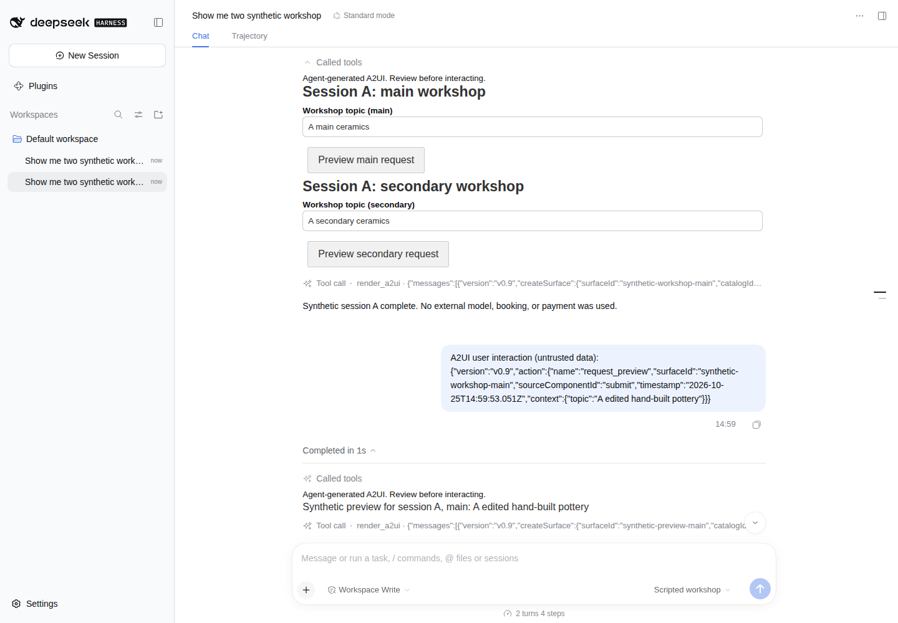

# DSH A2UI

## A2UI for DeepSeek Harness conversations

DSH A2UI is an independent plugin for rendering standard, agent-generated interfaces inside DeepSeek Harness conversations. An agent presents an interface, the user interacts, and that action becomes the next agent turn.

It uses the official A2UI schemas and renderer, with explicit validation, streamed previews, session-scoped actions, and replay that does not execute past interactions.

[See it in DSH](#see-it-in-deepseek-harness) · [Try it locally](#quick-start) · [Compatibility](#compatibility-and-support) · [Roadmap](#roadmap) · [Report an issue](https://github.com/sunxiuguo/dsh-a2ui/issues)

**Development preview: 0.1.0-alpha.13.** Alpha.13 makes clearing either half of a combined DateTimeInput clear the whole bound value, so explicit required checks on the submitting Button block empty submission rather than accepting malformed date/time fragments. Alpha.12 surfaces runtime expression failures as per-surface, dismissible notices without exposing evaluator payloads or changing action semantics. Alpha.11 preserves literal model/event metadata through submit and replay while enforcing disabled navigation at the actual function boundary. Alpha.10 adds native Slider naming and keyboard-to-action/replay coverage alongside the accessible TextField view through standard catalog extension APIs. The current alpha.13 bounded synthetic workflow passed in the official DSH Web host, including native plugin installation, HTTP RPC/WebSocket transport, two-session interaction, cancellation and restart restoration of authored history. The provider is scripted; live models and complete A2UI conformance are not certified. This is an additional project, not a replacement for DSH GenUI.

## See it in DeepSeek Harness

[](docs/full-host-acceptance.md)

The actual DSH Web conversation, not a standalone renderer page: two A2UI surfaces, a user action and the next agent turn's preview. **The model provider and workshop data are synthetic.** No live model, real account, booking, payment or customer data was used.

[Full-host acceptance run 40204726938](https://github.com/sunxiuguo/dsh-a2ui/actions/runs/40204726938) passed on 2026-10-25 at current alpha.13 source [`a8744445`](https://github.com/sunxiuguo/dsh-a2ui/commit/a8744445f4475c5a0fceb32a018a00617a954038). It exercised the official CLI and Web shell over actual HTTP RPC and WebSocket transport: two isolated sessions, a controlled pre-admission action failure and deliberate retry, native Stop and recovery, then graceful process restart and reopening without resending history.

The [restored Session B screenshot](docs/assets/full-host-alpha13-session-b-restored.png) and [full acceptance boundary and retained alpha.8 evidence](docs/full-host-acceptance.md) document that run. Both screenshots were reviewed for privacy and legibility. Authored messages and submitted-action previews persist; **unsent field drafts do not**. This evidence covers the exact source and scenario, not all models, components or failure modes.

### Standalone validation and replay demo

The earlier [23-second recording](https://github.com/user-attachments/assets/4449b7b4-e0e2-45b6-af94-641660bc6743) isolates the renderer: invalid input is blocked, a valid action is logged locally, and an explicitly exported recording restores an edited value after reload without resending its historical action. It also shows rejection of an unsupported runtime property.

This video is a standalone synthetic page, not the DSH host shown above. It comes from [`a8d1170`](https://github.com/sunxiuguo/dsh-a2ui/commit/a8d117041d9775347805a827d3d723a7601c1478) and [its passing capture run](https://github.com/sunxiuguo/dsh-a2ui/actions/runs/40086848889). See the [community showcase](https://github.com/a2ui-project/a2ui/discussions/3604) or [reproduce the capture](docs/showcase-recording.md).

## What this project is building

- **Interfaces that participate in the conversation.** A `render_a2ui` tool call creates a dedicated conversation node. Form actions return to the owning DSH session as explicitly labelled data, so the next agent turn can respond.
- **Standard payloads, official rendering.** The bridge uses A2UI message envelopes and the official basic catalog with `@a2ui/react` and `@a2ui/web_core`. It does not rename a proprietary component vocabulary as A2UI.
- **Visible compatibility boundaries.** Invalid schemas, unsupported catalogs, broken surface lifecycles and invalid final component references fail visibly. Unsupported features are not silently removed or rewritten.
- **Replay without accidental resubmission.** Portable recordings retain edited field values separately from model-authored messages. Historical actions remain evidence; importing a recording never sends them again.

The current examples are a workshop request form and a validation form. They are small, inspectable acceptance fixtures for the larger conversational experience.

## Quick start

Use **Node 24.19.0**, the verification baseline. No model key or account is needed for either local example.

```sh
git clone https://github.com/sunxiuguo/dsh-a2ui.git
cd dsh-a2ui
npm ci --ignore-scripts
```

Top-level dependencies are exact and transitive dependencies are locked. The install command disables lifecycle scripts.

### 1. Try rendering, validation and replay in a browser

```sh
npm run dev
```

Open the loopback URL printed by Vite.

1. Click **Stream synthetic example**, edit **Workshop topic**, then click **Preview request**. Its standard action envelope appears in the page's local log.
2. Click **Stream validation example**. Enter `bad` to see a field error and disabled button; enter `CD34` and click **Preview valid code** to log a valid action.
3. Click **Export recording** and copy the JSON from the recording editor. Reload the page, paste the saved JSON into the editor, then click **Restore recording**. The edited value returns, but the historical action is not sent again.

The page does not automatically save the form or recording editor across reloads. Its action sink is a local log, not a DSH session. See the [validation walkthrough](docs/validation-compatibility.md) for explicit `checks` and Button gating.

### 2. Follow an action into the next DSH agent turn

From the same source checkout:

```sh
npm run build:plugin
npm run demo:loop -- "Wheel-thrown pottery"
```

This executable walkthrough uses the real DSH AgentLoop, ToolRuntime, conversation assembler, official renderer and send controller. A scripted local model produces a form, the example edits and clicks it in jsdom, and the next real agent turn receives the action and renders a preview.

Expected result:

```text
PASS: 2 completed agent turns, 4 provider calls, 2 real tool results, 1 UI action.
```

The model and in-process transport are synthetic. This is a terminal walkthrough, not an interactive browser, live model or full DSH shell. It requires the source checkout and development dependencies; the plugin tarball does not include it. Read the [complete walkthrough and boundary](docs/synthetic-loop.md).

## How it fits into DSH

```text
Agent tool call: render_a2ui({ messages })
  → schema, compatibility and document validation
  → DSH tool-result presentation metadata
  → A2UI conversation node
  → official A2UI runtime + focused accessible TextField and Slider views
  → user interaction
  → validated action, sent as labelled data to the owning conversation
  → next agent turn
```

While a tool call is streaming, partial arguments can produce a preview. Its controls cannot send actions until final tool validation succeeds. SDK fixtures cover failed/cancelled-result withdrawal; the native-host run additionally verifies that Stop retires an in-progress preview before successful tool completion and that a later action still works.

The server and client are separate plugin entries. Without the browser plugin, the tool's text receipt confirms validation only, not that an interface appeared. The client submits action data through DSH's conversation send controller; client-side checks are not authorization or a substitute for server validation.

Start with [`demo/fixture.ts`](demo/fixture.ts) or [`demo/validation-fixture.json`](demo/validation-fixture.json) for the `messages` argument. The implementation lives in [`src/dsh`](src/dsh), with shared [validation](src/protocol.ts), [rendering](src/surface.tsx) and [recording](src/replay.ts) modules.

## Compatibility and support

This matrix describes the alpha's bounded implementation and evidence, not complete protocol or production certification.

| Area | Current implementation and evidence | Remaining boundary |
| --- | --- | --- |
| A2UI protocol | v0.9 and v0.9.1 envelopes; unchanged official schemas pinned from v0.9.1 | A2UI v1.0 is not supported. |
| Official runtime | `@a2ui/react` and `@a2ui/web_core` 0.14.0 | Other renderer versions and cross-renderer parity are not certified. |
| Basic catalog | Contract fixtures for 15 permitted components and 13 permitted functions; separate function-result tests | Full variants, interactions, locales, accessibility and semantic conformance remain open. See [coverage](docs/catalog-coverage.md). |
| TextField accessibility | Alpha.9 plugin-owned view using official schema/binder; associated native labels across four variants, dynamic names and explicit validation descriptions | Other component accessibility and screen-reader certification remain open. See [scope and evidence](docs/textfield-accessibility.md). |
| Slider accessibility | Plugin-owned native range view with associated labels, reactive descriptions and unchanged numeric binder | v0.9/v0.9.1 default step 1 only; inherited authored-value sanitization remains. See [scope and evidence](docs/slider-accessibility.md). |
| Literal metadata and execution policy | Model/resolved-event data preserve literal component/call fields; the renderer denies openUrl at execution as well as authored syntax | Inline authored definitions remain conservative; runtime errors produce a fixed per-surface notice, not atomic action failures. Dismissal acknowledges an observation, not recovery. See [boundary and workflow](docs/literal-data-policy.md) and [runtime notice lifecycle](docs/runtime-warnings.md). |
| DateTimeInput clearing | Either cleared half of a combined selection becomes an empty bound value; explicit checks, action and portable replay preserve that state | Atomic clear, not partial draft storage or comprehensive date/time parsing. See [workflow and limits](docs/datetime-clearing.md). |
| Validation | Explicit `checks` with `regex`, including independently gated Buttons | `TextField.validationRegexp` is valid A2UI but ignored by the pinned runtime, so alpha.8 rejects it with `COMPATIBILITY`, even when empty or combined with `checks`. No automatic rewrite occurs. |
| Streaming | Incremental JSONL and DSH tool-argument previews; native Web-host streaming over HTTP RPC/WebSocket with inert previews and Stop cancellation | The provider is scripted. Cancellation during/after tool execution and broader network-recovery behavior are not certified. |
| Actions | Two native sessions with overlapping surface IDs; actions reach the owning next turn. Controlled pre-admission HTTP rejection retains edits; deliberate retry is admitted once in the tested scenario. | No automatic retry was observed in the bounded test. This is not an exactly-once guarantee; unconfirmed delivery can still be ambiguous. |
| Replay and state | Export/import preserves field snapshots without sending history; identical document resync retains state in the same mounted node | A changed document, node, preview/error state or teardown resets that in-memory state. Unsent edits do not survive a DSH reload. |
| Durable history | Both native sessions reopen after graceful host restart and a fresh browser context, with exact authored metadata and submitted-action previews; no new model call or action is sent by restoration. | Unsent drafts are not durable. Crash recovery, host-managed export/import and restoration of every interaction state remain open. |
| DSH integration | Official **0.2.0-rc.2 CLI and Web shell**, Cordis **4.0.5**; packed alpha.13 installation and the bounded native-host scenario passed. | Other versions, live-model workflows, Code Mode and production deployment are not certified. See [full-host evidence](docs/full-host-acceptance.md). |

Upstream identifies [A2UI v0.9.1 as current and v1.0 as a candidate](https://a2ui.org/). This bridge's support is narrower than the standard. See the [packed acceptance ledger](docs/packed-host-acceptance.md) for the exact test boundaries and alpha regression history.

Additional [rc.3 validation](validation/rc3/README.md) passed with exact
**DSH 0.2.1-rc.3** packages: the synthetic SDK experiment and a separately
authorized native CLI installation/HTTP protocol experiment. The unchanged
alpha.13 artifact passed scripted two-session tool/action, cancellation and
canonical-history restart checks. Normal **pnpm 11.19.0** resolution succeeded;
normal **npm 11.9.0** resolution separately failed with `ERESOLVE` on the unchanged
prerelease peer range. Run `python3 validation/rc3/validate-rc3.py` in an isolated
cloud container to reproduce the SDK checks only. Existing native browser
evidence uses DSH 0.2.0-rc.2; rc.3 browser rendering/clicks, live models, production
compatibility and marketplace eligibility remain unverified. This is no adoption
claim and does not broaden the published compatibility ranges.

### DSH package installation

Build and inspect a local plugin artifact:

```sh
npm run build:plugin
npm run test:packed
npm pack --ignore-scripts
```

The package contains server and client entries plus its `cordis.patch.yml` bundle contribution. It is **not published to npm**.

For a prebuilt package, download the [alpha.13 release tarball](https://github.com/sunxiuguo/dsh-a2ui/releases/download/v0.1.0-alpha.13/dsh-a2ui-0.1.0-alpha.13.tgz) and use the local-tarball command below. The plugin directory may also display a generic `github:sunxiuguo/dsh-a2ui` shortcut; that source-install shortcut is **not a supported installation route for this alpha**. This repository does not commit `lib/` or define an automatic install-time build. Allowing lifecycle scripts alone does not replace the explicit build-and-pack steps above.

If you already have the compatible DSH **0.2.0-rc.2** installation and a complete Web profile, replace `YOUR_EXISTING_WEB_PROFILE` with that profile's name and install the local tarball using the native CLI syntax exercised by the acceptance run:

```sh
dsh plugin --profile YOUR_EXISTING_WEB_PROFILE add ./dsh-a2ui-0.1.0-alpha.13.tgz --ignore-scripts
```

This command targets that existing profile; it does not create a complete DSH installation. Configure any real model and its credentials yourself through DSH's normal settings. Real-model behavior remains outside this acceptance result.

### Update, roll back or remove from that profile

**Stop the DSH process using this profile before replacing or removing the package.** Keep the previously working tarball and its source commit before updating. The pinned DSH 0.2.0-rc.2 plugin manager requires a process restart to load a replacement JavaScript module generation; a successful package command does not prove that an already-running host or browser is using the new code.

For an update, build and test the chosen source revision as above, then use `add` again with its exact local tarball and the **same** profile. For rollback, use the same command with the retained prior tarball. Do not use an npm registry update for this unpublished package. Replace `CHOSEN_TARBALL.tgz` with the actual filename:

```sh
dsh plugin --profile YOUR_EXISTING_WEB_PROFILE add ./CHOSEN_TARBALL.tgz --ignore-scripts
dsh plugin --profile YOUR_EXISTING_WEB_PROFILE list dsh-a2ui
```

Restart that profile using your existing DSH launch command, then reload its Web page. Check both the installed version and a fresh synthetic `render_a2ui` interaction; a text validation receipt alone does not establish client rendering. A bundle you deliberately disabled remains disabled when replaced—check the profile's plugin selection rather than assuming an update re-enables it.

To remove only this plugin from the stopped profile:

```sh
dsh plugin --profile YOUR_EXISTING_WEB_PROFILE remove dsh-a2ui --config.ignore-scripts=true
dsh plugin --profile YOUR_EXISTING_WEB_PROFILE list dsh-a2ui
```

Restart the same profile and reload its Web page. Do not delete the profile, conversation files or unrelated plugins. Removal is not an export or a migration of A2UI history; rendering old A2UI nodes without the plugin, or restoring them after reinstall/rollback, is not certified. Preserve any needed recordings and your existing host backup before changing versions. Unsent field drafts are not durable.

The removal command uses pnpm’s single-command `--config.ignore-scripts=true` form; it does not change persistent or global settings.

The ordinary packed checks verify official dependency-spec reconciliation after synthetic package placement (not an actual package-version swap): a new bundle is selected, replacement does not duplicate it or re-enable a deliberately disabled bundle, removal prunes its selection, and unrelated metadata remains. They do **not** execute native CLI update/removal, live-host restart or browser recovery. The restart requirement comes from the pinned [official plugin-manager package](https://www.npmjs.com/package/@deepseek-ai/dsh-plugin-manager/v/0.2.0-rc.2). These instructions apply to the published v0.9/v0.9.1 plugin only; they do not enable an experimental A2UI v1 implementation.

The official DSH 0.2.0-rc.2 CLI installed the packed **alpha.8** plugin into a new complete Web profile in the [2026-10-24 full-host acceptance](docs/full-host-acceptance.md). The shipped shell loaded it and completed the bounded synthetic interaction/restart scenario, with lifecycle scripts disabled. This supersedes the earlier alpha.3 empty-profile installation-only evidence. Code Mode and other host versions remain unverified.

The [2026-10-25 alpha.13 acceptance](docs/full-host-acceptance.md#alpha13-current-source-verification) additionally executed the actual native CLI on a stopped disposable profile: alpha.8 → alpha.13 → alpha.8, replacement with a deliberately disabled bundle, removal, and reinstall. Installed bytes matched each exact source build, and unrelated profile metadata and bundle selections were retained. A separate fresh alpha.13 native Web profile passed interaction and graceful-restart restoration. **This does not certify migration or recovery of existing histories across version changes or removal.**

The full-host harness is a separately authorized, isolated acceptance experiment, not part of the ordinary local quick start or an automatically recurring test. Its temporary native test credentials are removed during verified cleanup; it does not import an existing user profile.

## Deployment boundaries

The initial policy is deliberately narrower than A2UI:

- Only the pinned official basic catalog is accepted. No arbitrary remote catalogs, dynamic code, HTML injection or transport fetching are included.
- External media components and navigation are disabled, including external links and media in Markdown. These are deployment restrictions, not claims that A2UI forbids them.
- Documents are limited to 256 KiB, 512 messages, 8 active surfaces and 256 components per surface.
- Actions are limited to 16 KiB each, 128 attempts per mounted A2UI document session, and a 256 KiB retained/in-flight budget.
- Recordings bound authored history, field snapshots and actions separately, so snapshots do not consume the 512-message history allowance. Import restores UI state only; past actions never execute.
- The plugin exposes no credential or payment actions. All examples use synthetic data; the separately authorized full-host harness creates only temporary native test authentication and verifies its removal.

## Roadmap

1. **Expand native-host coverage.** Build on the passing synthetic Web-host scenario with live-model workflows, additional cancellation phases, network interruption/reconnection, crash recovery and supported deployment configurations.
2. **Complete stable A2UI support.** Cover the full basic catalog, theme/validation/function semantics, accessibility and cross-renderer behavior. Introduce a deliberate host-managed policy before enabling media or navigation.
3. **Persist more interaction state.** Authored history already survives the tested graceful restart. Evaluate opt-in draft persistence only for a demonstrated workflow, with an explicit privacy/lifecycle contract; extend submitted-state restoration with versioned migrations and no accidental action replay.
4. **Add protocols through explicit adapters.** Evaluate A2UI v1.0 as its contract stabilizes and other mainstream protocols without disguising proprietary payloads as standards.

A feature moves to supported when its end-to-end evidence and limitations are documented. The native-host result verifies a bounded workflow; complete protocol support remains the direction.

## Development and feedback

```sh
npm test
npm run typecheck
npm run build
npm run build:plugin
npm run test:packed
npm run test:stream
```

The [verification ledger](docs/verification.md) explains the test layers and exact-commit browser evidence. jsdom tests do not establish browser layout or accessibility. The existing CI uses a standard GitHub-hosted runner, read-only repository permissions and no real account or model credentials; its real-browser checks keep the browser sandbox enabled. A successful run is evidence for its own commit only.

Useful starting points:

- [Catalog coverage](docs/catalog-coverage.md)
- [Validation and runtime compatibility](docs/validation-compatibility.md)
- [Native Web-host acceptance and screenshots](docs/full-host-acceptance.md)
- [Packed SDK fixture acceptance](docs/packed-host-acceptance.md)
- [Synthetic agent-loop walkthrough](docs/synthetic-loop.md)
- [Recording the browser showcase](docs/showcase-recording.md)
- [Alternatives and project scope](docs/alternatives.md)

To [report a problem](https://github.com/sunxiuguo/dsh-a2ui/issues), include the source commit, DSH/runtime versions, a minimal synthetic payload, steps and expected behavior. Do not include credentials or customer data.

Other DSH A2UI integrations already exist. This project's focus is official-renderer interoperability, explicit rejection without silent sanitization, and non-executing portable replay. Those are testable design choices, not claims of being first, superior, adopted or production-ready.

## License

MIT for project-authored code. Official A2UI schemas and bundled dependencies retain their respective notices; see [NOTICE.md](NOTICE.md) and [the vendored A2UI license](vendor/a2ui/LICENSE). Not affiliated with or endorsed by DeepSeek, Google, or the A2UI project.

### Using an AG-UI gateway?

Read the [gateway interoperability boundary](docs/ag-ui-gateway-boundary.md) before combining plugins. Extracted standard A2UI operations can be compatible, but tool arguments, cumulative snapshots, settled results and action identities need explicit integration. This native DSH plugin is not a drop-in AG-UI client.
