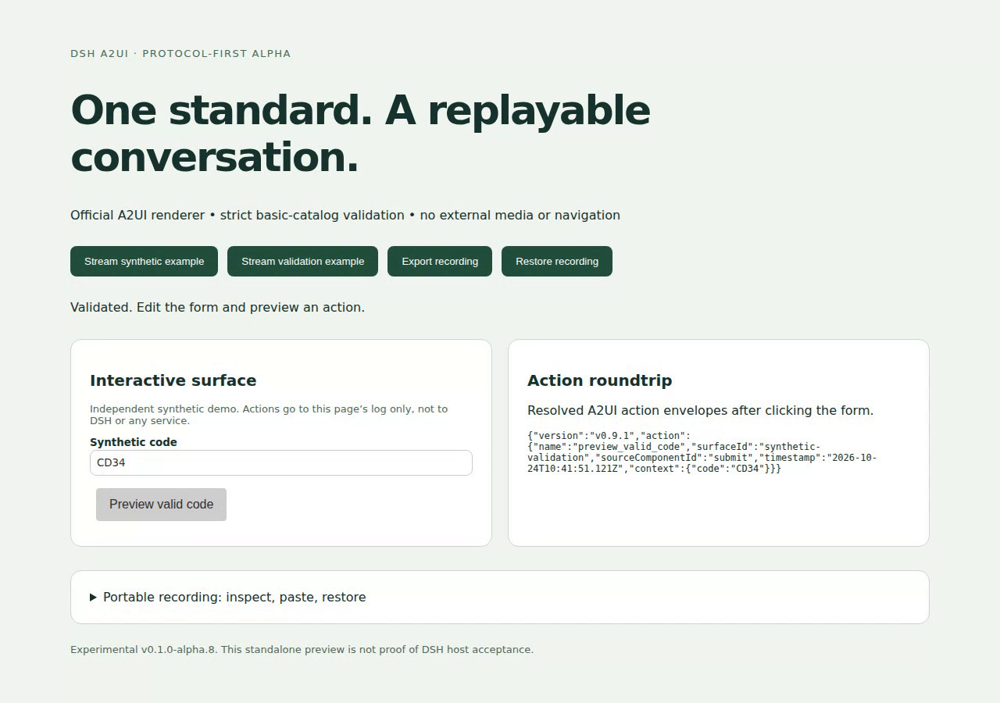

# DSH A2UI

## A2UI for DeepSeek Harness conversations

DSH A2UI is an independent plugin project for bringing standard, agent-generated interfaces into DeepSeek Harness. The goal is a complete conversation loop: the agent presents an interface, the user interacts, and that action becomes the next agent turn.

It uses the official A2UI schemas and renderer, with explicit validation, streamed previews, session-scoped actions, and replay that does not execute past interactions.

[Watch the synthetic demo](https://github.com/a2ui-project/a2ui/discussions/3604) · [Try it locally](#quick-start) · [Compatibility](#compatibility-and-support) · [Roadmap](#roadmap) · [Report an issue](https://github.com/sunxiuguo/dsh-a2ui/issues)

**Development preview: 0.1.0-alpha.8.** The standalone browser and bounded DSH SDK workflows are reproducible today. Complete A2UI support inside a full DSH Web host is the product direction, not a completed acceptance claim. This is an additional project, not a replacement for DSH GenUI.

## See the interaction

[](https://github.com/a2ui-project/a2ui/discussions/3604)

The [23-second recording](https://github.com/user-attachments/assets/4449b7b4-e0e2-45b6-af94-641660bc6743) shows the real standalone UI: invalid input is blocked, a valid action is logged, and an explicitly exported recording restores the edited value after a page reload without resending its historical action. It also shows a visible rejection of an unsupported runtime property.

**Synthetic data only.** There is no live model, external service, booking, payment, or customer data in this demo. The screenshot is an unmodified frame from the recording at 8.5 seconds. Both come from source commit [`a8d1170`](https://github.com/sunxiuguo/dsh-a2ui/commit/a8d117041d9775347805a827d3d723a7601c1478), whose [acceptance run passed](https://github.com/sunxiuguo/dsh-a2ui/actions/runs/40086848889). This evidence covers that commit, not later revisions. See [how to reproduce the capture](docs/showcase-recording.md).

## What this project is building

- **Interfaces that participate in the conversation.** A `render_a2ui` tool call creates a dedicated conversation node. Form actions return to the owning DSH session as explicitly labelled data, so the next agent turn can respond.
- **Standard payloads, official rendering.** The bridge uses A2UI message envelopes and the official basic catalog with `@a2ui/react` and `@a2ui/web_core`. It does not rename a proprietary component vocabulary as A2UI.
- **Visible compatibility boundaries.** Invalid schemas, unsupported catalogs, broken surface lifecycles and invalid final component references fail visibly. Unsupported features are not silently removed or rewritten.
- **Replay without accidental resubmission.** Portable recordings retain edited field values separately from model-authored messages. Historical actions remain evidence; importing a recording never sends them again.

The current examples are a workshop request form and a validation form. They are small, inspectable acceptance fixtures for the larger conversational experience.

## Quick start

Use **Node 24.19.0**, the verification baseline. No model key or account is needed for either local example.

```sh
git clone https://github.com/sunxiuguo/dsh-a2ui.git
cd dsh-a2ui
npm ci --ignore-scripts
```

Top-level dependencies are exact and transitive dependencies are locked. The install command disables lifecycle scripts.

### 1. Try rendering, validation and replay in a browser

```sh
npm run dev
```

Open the loopback URL printed by Vite.

1. Click **Stream synthetic example**, edit **Workshop topic**, then click **Preview request**. Its standard action envelope appears in the page's local log.
2. Click **Stream validation example**. Enter `bad` to see a field error and disabled button; enter `CD34` and click **Preview valid code** to log a valid action.
3. Click **Export recording** and copy the JSON from the recording editor. Reload the page, paste the saved JSON into the editor, then click **Restore recording**. The edited value returns, but the historical action is not sent again.

The page does not automatically save the form or recording editor across reloads. Its action sink is a local log, not a DSH session. See the [validation walkthrough](docs/validation-compatibility.md) for explicit `checks` and Button gating.

### 2. Follow an action into the next DSH agent turn

From the same source checkout:

```sh
npm run build:plugin
npm run demo:loop -- "Wheel-thrown pottery"
```

This executable walkthrough uses the real DSH AgentLoop, ToolRuntime, conversation assembler, official renderer and send controller. A scripted local model produces a form, the example edits and clicks it in jsdom, and the next real agent turn receives the action and renders a preview.

Expected result:

```text
PASS: 2 completed agent turns, 4 provider calls, 2 real tool results, 1 UI action.
```

The model and in-process transport are synthetic. This is a terminal walkthrough, not an interactive browser, live model or full DSH shell. It requires the source checkout and development dependencies; the plugin tarball does not include it. Read the [complete walkthrough and boundary](docs/synthetic-loop.md).

## How it fits into DSH

```text
Agent tool call: render_a2ui({ messages })
  → schema, compatibility and document validation
  → DSH tool-result presentation metadata
  → A2UI conversation node
  → official A2UI renderer
  → user interaction
  → validated action, sent as labelled data to the owning conversation
  → next agent turn
```

While a tool call is streaming, partial arguments can produce a preview. Its controls cannot send actions until final tool validation succeeds. Failed or cancelled results withdraw the preview within the tested SDK pipeline.

The server and client are separate plugin entries. Without the browser plugin, the tool's text receipt confirms validation only, not that an interface appeared. The client submits action data through DSH's conversation send controller; client-side checks are not authorization or a substitute for server validation.

Start with [`demo/fixture.ts`](demo/fixture.ts) or [`demo/validation-fixture.json`](demo/validation-fixture.json) for the `messages` argument. The implementation lives in [`src/dsh`](src/dsh), with shared [validation](src/protocol.ts), [rendering](src/surface.tsx) and [recording](src/replay.ts) modules.

## Compatibility and support

This matrix describes the alpha's bounded implementation and evidence, not complete protocol or production certification.

| Area | Current implementation and evidence | Remaining boundary |
| --- | --- | --- |
| A2UI protocol | v0.9 and v0.9.1 envelopes; unchanged official schemas pinned from v0.9.1 | A2UI v1.0 is not supported. |
| Official runtime | `@a2ui/react` and `@a2ui/web_core` 0.14.0 | Other renderer versions and cross-renderer parity are not certified. |
| Basic catalog | Contract fixtures for 15 permitted components and 13 permitted functions; separate function-result tests | Full variants, interactions, locales, accessibility and semantic conformance remain open. See [coverage](docs/catalog-coverage.md). |
| Validation | Explicit `checks` with `regex`, including independently gated Buttons | `TextField.validationRegexp` is valid A2UI but ignored by the pinned runtime, so alpha.8 rejects it with `COMPATIBILITY`, even when empty or combined with `checks`. No automatic rewrite occurs. |
| Streaming | Incremental JSONL and DSH tool-argument previews; actual SDK follow/assistant-stream success and cancellation fixtures | The physical carrier is in-process; full-shell and HTTP/WebSocket cancellation are unverified. |
| Actions | Session-scoped send, visible delivery errors, retained edited values after a rejected send, no automatic retry | An unconfirmed send may be ambiguous. Check the conversation before submitting again. |
| Replay and state | Export/import preserves field snapshots without sending history; identical document resync retains state in the same mounted node | A changed document, node, preview/error state or teardown resets that in-memory state. Unsent edits do not survive a DSH reload. |
| Durable history | Official JSONL backend fixtures restore model-authored tool-result metadata; sent actions use ordinary DSH conversation history | Durable browser drafts, host-managed export/import and action-aware full UI restoration remain open. |
| DSH integration | Exact SDK **0.2.0-rc.2**, Cordis **4.0.5**; packed server, client-loader, scoped UI and agent-loop fixtures | Broad semver ranges do not certify other versions. Full Web shell, real network transport, persistent reopen and live-model acceptance remain unverified. |

Upstream identifies [A2UI v0.9.1 as current and v1.0 as a candidate](https://a2ui.org/). This bridge's support is narrower than the standard. See the [packed acceptance ledger](docs/packed-host-acceptance.md) for the exact test boundaries and alpha regression history.

### DSH package installation

Build and inspect a local plugin artifact:

```sh
npm run build:plugin
npm run test:packed
npm pack --ignore-scripts
```

The package contains server and client entries plus its `cordis.patch.yml` bundle contribution. It is **not published to npm**. Install the local artifact through your supported DSH profile plugin-package workflow; this repository does not configure your global profile, model, credentials or permissions.

The official DSH 0.2.0-rc.2 CLI with pnpm 11.25.0 installed an **alpha.3** tarball into an empty isolated profile on 2026-10-23, with lifecycle scripts disabled, correct package bytes and automatic bundle registration. That profile lacked the eight host peers. This historical installation result is not alpha.8 full-host activation or a complete runnable DSH deployment. Code Mode rendering is not certified.

## Deployment boundaries

The initial policy is deliberately narrower than A2UI:

- Only the pinned official basic catalog is accepted. No arbitrary remote catalogs, dynamic code, HTML injection or transport fetching are included.
- External media components and navigation are disabled, including external links and media in Markdown. These are deployment restrictions, not claims that A2UI forbids them.
- Documents are limited to 256 KiB, 512 messages, 8 active surfaces and 256 components per surface.
- Actions are limited to 16 KiB each, 128 attempts per mounted A2UI document session, and a 256 KiB retained/in-flight budget.
- Recordings bound authored history, field snapshots and actions separately, so snapshots do not consume the 512-message history allowance. Import restores UI state only; past actions never execute.
- No credential or payment actions are included. All examples and acceptance fixtures use synthetic data.

## Roadmap

1. **Complete the DSH conversation experience.** Prove the packed plugin in a supported full Web host: streaming, HTTP/WebSocket delivery, click → model turn, persistent reopen, multiple surfaces, failed delivery and cancellation.
2. **Complete stable A2UI support.** Cover the full basic catalog, theme/validation/function semantics, accessibility and cross-renderer behavior. Introduce a deliberate host-managed policy before enabling media or navigation.
3. **Make interaction history durable.** Restore edits and submitted state accurately across host reloads, with versioned migrations and no accidental action replay.
4. **Add protocols through explicit adapters.** Evaluate A2UI v1.0 as its contract stabilizes and other mainstream protocols without disguising proprietary payloads as standards.

A feature moves to supported when its end-to-end evidence and limitations are documented. The standalone demo and SDK fixtures are steps toward that destination, not the final product boundary.

## Development and feedback

```sh
npm test
npm run typecheck
npm run build
npm run build:plugin
npm run test:packed
npm run test:stream
```

The [verification ledger](docs/verification.md) explains the test layers and exact-commit browser evidence. jsdom tests do not establish browser layout or accessibility. The existing CI uses a standard GitHub-hosted runner, read-only repository permissions and no real account or model credentials; its real-browser checks keep the browser sandbox enabled. A successful run is evidence for its own commit only.

Useful starting points:

- [Catalog coverage](docs/catalog-coverage.md)
- [Validation and runtime compatibility](docs/validation-compatibility.md)
- [Packed host acceptance](docs/packed-host-acceptance.md)
- [Synthetic agent-loop walkthrough](docs/synthetic-loop.md)
- [Recording the browser showcase](docs/showcase-recording.md)
- [Alternatives and project scope](docs/alternatives.md)

To [report a problem](https://github.com/sunxiuguo/dsh-a2ui/issues), include the source commit, DSH/runtime versions, a minimal synthetic payload, steps and expected behavior. Do not include credentials or customer data.

Other DSH A2UI integrations already exist. This project's focus is official-renderer interoperability, explicit rejection without silent sanitization, and non-executing portable replay. Those are testable design choices, not claims of being first, superior, adopted or production-ready.

## License

MIT for project-authored code. Official A2UI schemas and bundled dependencies retain their respective notices; see [NOTICE.md](NOTICE.md) and [the vendored A2UI license](vendor/a2ui/LICENSE). Not affiliated with or endorsed by DeepSeek, Google, or the A2UI project.
